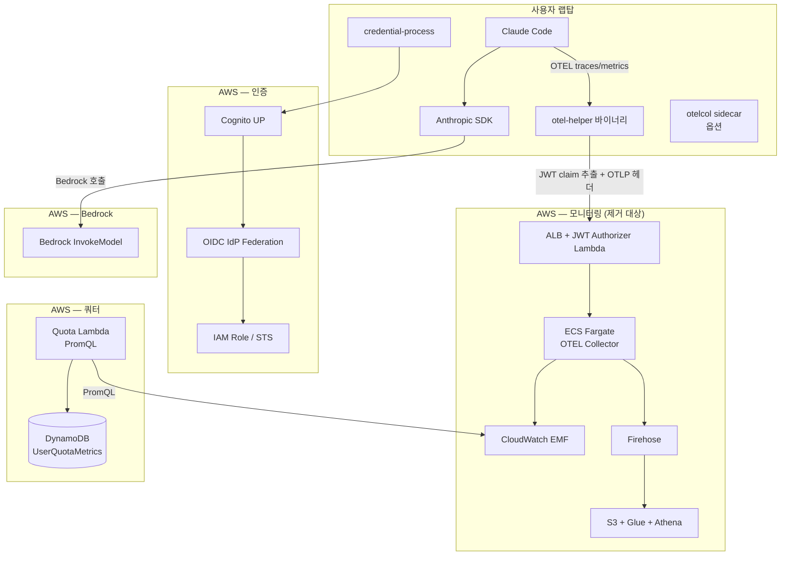
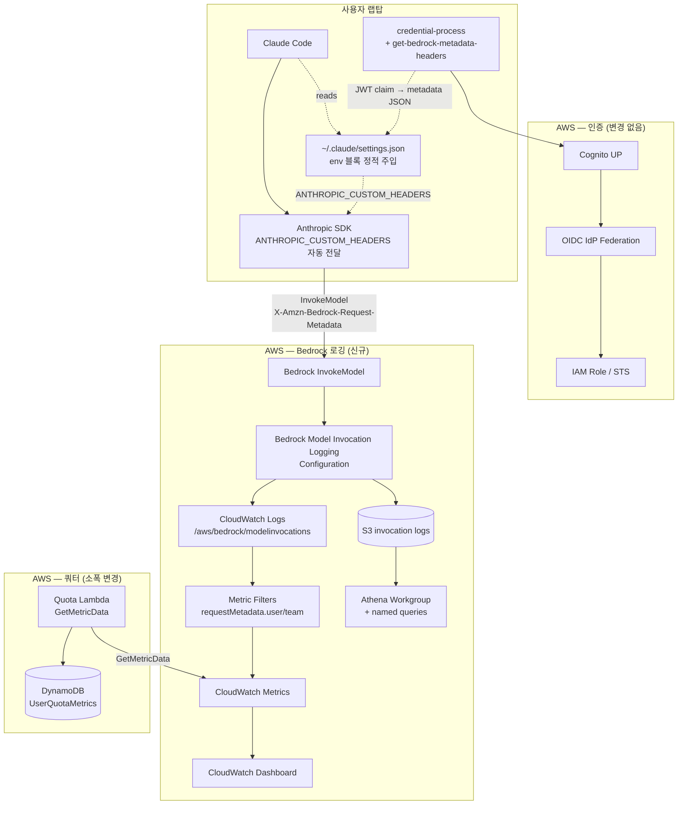
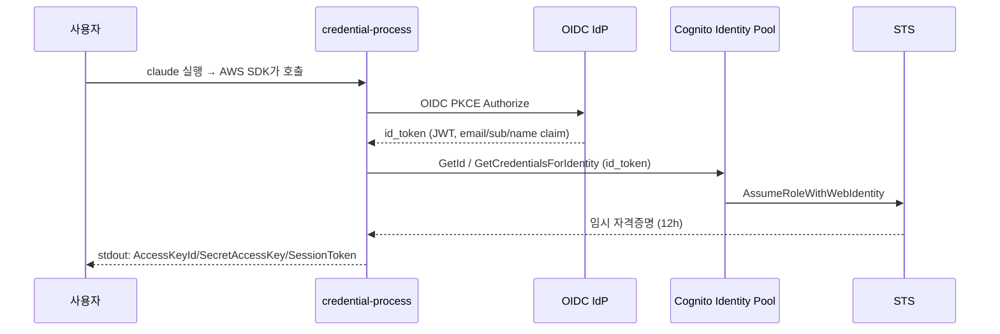
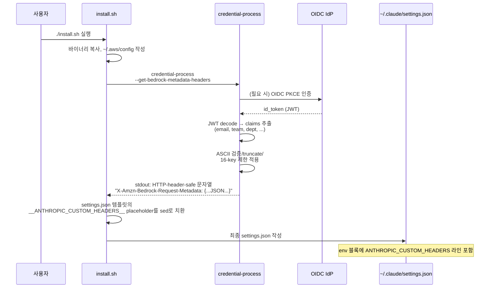
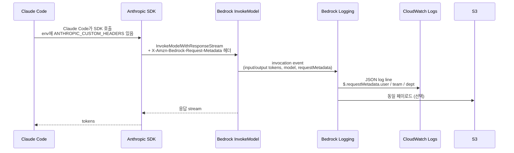
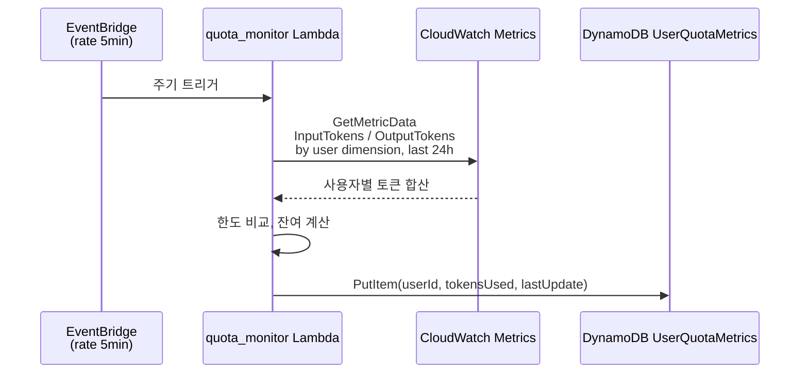

# Design Document: bedrock-native-logging

## Overview

### 변경 동기

상류 ccwb 솔루션은 사용자별 토큰 사용량 가시성을 OTEL 파이프라인(otel-helper 바이너리 → ALB+ECS Fargate 위 OTEL Collector → CloudWatch EMF + Firehose+S3+Glue+Athena)으로 확보한다. 검증 결과 같은 가시성 신호(사용자/팀별 토큰 합산, 모델별 분해)를 Bedrock 자체 기능만으로 얻을 수 있음이 확인됐다.

핵심 발견은 두 가지다.

- AWS Bedrock의 매직 헤더 `X-Amzn-Bedrock-Request-Metadata`가 InvokeModel/InvokeModelWithResponseStream 호출에 자동 전달되며, model invocation logging이 활성화돼 있으면 S3 또는 CloudWatch Logs의 `requestMetadata` 필드에 그대로 기록된다.
- Anthropic SDK가 정의한 환경변수 `ANTHROPIC_CUSTOM_HEADERS`를 Claude Code 실행 직전에 설정하면 SDK가 그 값을 모든 Bedrock 호출에 헤더로 전달한다.

이 두 가지를 결합하면 OTEL 파이프라인 전체와 그것을 떠받치는 VPC/NAT/ALB/ECS/Lambda authorizer가 불필요해진다. 클라이언트 측에서도 otel-helper 바이너리, sidecar collector, EMF 차원 화이트리스트, two-layer 캐시가 사라진다. 같은 사용자 attribution을 유지하면서 운영 부담은 대폭 줄어든다.

### 핵심 결정

| 결정 | 채택안 | 근거 |
|------|--------|------|
| 텔레메트리 경로 | OTEL 제거, Bedrock model invocation logging 사용 | 동일 가시성, 운영 비용 ~$50/월 절감, 컴포넌트 수 대폭 감소 |
| 사용자 메타데이터 주입 | `ANTHROPIC_CUSTOM_HEADERS` 환경변수에 `X-Amzn-Bedrock-Request-Metadata` 매직 헤더 포함 | Bedrock-native, 추가 helper 프로세스 0 |
| 주입 시점 | install 시점 정적 주입 (settings.json `env` 블록) | claude wrapper 셸 스크립트 회피, Claude Code가 직접 읽음 |
| 주입 책임 | credential-process가 JWT claim 추출 후 메타데이터 JSON 빌드, install.sh가 settings.json placeholder 치환 | 단일 진실 소스 (JWT) 유지, 인증 흐름과 일관성 |
| 노선 | 별개 fork (upstream PR 아님) | OTEL 옵션을 통째 교체할 수 있음 |
| 스택 수 | 9개 → 5개 | networking(VPC/NAT) 제거, monitoring(OTEL collector) 제거, analytics(Firehose/Glue) 제거. cowork-dashboard 별도 추적 |

### 보존 영역

다음은 변경하지 않는다. 이미 사내 표준으로 검증되어 있고 OTEL 제거와 직교한다.

- Cognito User Pool + 외부 IdP federation (카카오/Okta/Azure 등)
- IAM OIDC Provider + Federated Role
- credential-process의 OIDC PKCE + STS 교환 + Quota check 흐름
- Quota Lambda + DynamoDB UserQuotaMetrics 테이블 (스키마 그대로, 데이터 출처만 교체)
- Distribution(presigned S3) 방식의 패키지 배포
- CodeBuild 빌드 매트릭스 (Linux/macOS/Windows × x86_64/arm64)


## Architecture

### 컴포넌트 다이어그램: 변경 전 (현재 ccwb upstream)



### 컴포넌트 다이어그램: 변경 후 (본 fork)




### 주요 데이터 흐름

#### 인증/인가 흐름 (변경 없음)



이 흐름은 본 fork에서 한 글자도 바꾸지 않는다.

#### 사용자 메타데이터 주입 흐름 (변경 영역, 핵심)

install 시점에 한 번 실행되는 정적 주입 흐름이다.



정적 주입의 한계와 대응:

- settings.json의 `env` 블록은 Claude Code가 프로세스 시작 시 한 번 읽는다. 사용자별로 다른 값이 들어가야 하므로, install 시점에 그 사용자 고유의 값으로 치환한다.
- JWT는 보통 12시간마다 재발급된다. JWT claim이 변경되면 settings.json에 박혀 있는 값과 차이가 생긴다. → §Error Handling에서 12-hour staleness 한계와 대응 정책을 다룬다.

#### Bedrock 호출 → Logging 흐름 (변경 영역)



#### Quota Check 흐름 (변경 영역)

PromQL Query API 의존성을 제거하고 두 갈래 중 하나로 갈아끼운다.



Athena 갈래는 일/주/월 누적이 필요한 경우에만 사용한다. 5분 주기의 quota 가시성은 GetMetricData만으로 충분하다(Bedrock metric filter는 분 해상도까지 보장).

DynamoDB 스키마는 그대로 둔다. `tokensUsed` 필드의 출처가 PromQL → CloudWatch GetMetricData로 바뀌는 것이 전부다. 따라서 credential-process의 quota check 코드(이미 DynamoDB만 읽는다)는 변경 불요.

### CFN 스택 구조 변경: 9개 → 5개

| 현재 (upstream) | 본 fork | 변화 |
|----------------|---------|------|
| auth (cognito-user-pool-setup + identity-pool + bedrock-auth-*) | auth | 그대로 |
| networking (VPC + NAT + subnets) | (제거) | monitoring 전용이었으면 통째 제거. 현재 본인 환경은 monitoring 전용 → 제거 |
| monitoring (otel-collector.yaml: ALB + ECS + JWT authorizer Lambda) | (제거) | 통째 제거 |
| analytics (analytics-pipeline.yaml: Firehose + S3 + Glue) | (제거) | 통째 제거 |
| dashboard (claude-code-dashboard.yaml) | dashboard (수정) | 데이터 소스를 EMF metric → Bedrock log metric filter로 교체 |
| s3bucket | s3bucket | 그대로 (배포 패키지용) |
| distribution (distribution.yaml) | distribution | 그대로 |
| cowork-dashboard | (별도 추적) | §Out of Scope (tasks.md) |
| quota (quota-monitoring.yaml) | quota (수정) | Lambda 데이터 소스만 교체 |
| — | bedrock-logging (신규) | S3 bucket + Bedrock logging config + metric filters + Athena workgroup |

결과: **auth, dashboard, quota, distribution, bedrock-logging** = 5개 스택. (s3bucket은 배포 산출물 보관용으로 별도 카운트하면 6개)


---

## Components and Interfaces

### ccwb 기존 온보딩 흐름과의 통합 (최우선 요구사항)

본 fork는 ccwb의 5단계 워크플로우(`init` → `configure` → `deploy` → `package` → `distribute`)를 **그대로 유지**한다. 명령어 시그니처, 사용자 대화 흐름, 명령어 출력 형식 모두 호환을 유지한다. fork를 처음 받은 운영자는 동일한 명령어를 동일한 순서로 실행하며, 변경된 동작은 출력 메시지에서 자연스럽게 노출된다.

각 단계별 변경 지점은 다음과 같다.

#### `ccwb init` (대화형 초기 셋업)

기존 동작: IdP 선택, AWS 리전 선택, monitoring_mode 선택(none/sidecar/central), analytics_enabled 선택, distribution_type 선택.

본 fork 변경:

- **monitoring_mode 질문 자체를 제거한다.** 기본 동작이 Bedrock model invocation logging이며 선택지가 없다. 옵션이 줄어들어 대화 분기가 단순해진다.
- analytics_enabled 질문도 제거한다. Athena workgroup은 bedrock-logging 스택에 기본 포함된다(저비용이라 분리 안 함).
- 기존 `monitoring_enabled`, `monitoring_mode`, `analytics_enabled`, `metrics_log_group` 등 프로파일 필드는 유지하되 default를 새 동작에 맞춰 잠금(`monitoring_enabled=true`, `monitoring_mode="bedrock-native"`). `~/.ccwb/profiles/<name>.json`을 그대로 가진 기존 사용자가 fork에 들어와도 schema 호환.
- 신규 프로파일 필드 추가:
  - `bedrock_logging_destination`: `"cloudwatch"` (기본) 또는 `"s3"` 또는 `"both"`. CFN 파라미터로 주입.
  - `data_retention_days`: 기존 필드 그대로(default 90). bedrock-logging 스택의 S3 lifecycle과 CW Logs retention 양쪽에 적용.

JWT claim → 매직 헤더 변환은 별도 매핑 필드 없이 **passthrough + dashboard alias** 방식으로 한다. credential-process가 OIDC 보일러플레이트(`iss`/`aud`/`exp`/`iat`/`nonce`/`token_use`/`event_id`/`origin_jti`/...)만 제외하고 나머지 claim을 그대로 헤더에 박는다. 그 위에 fixed 3-key alias(`user`/`team`/`dept`)를 가장 흔한 IdP claim 후보(`email`/`cognito:username`/`sub` for user; `custom:team`/`cognito:groups`/`groups` for team; `custom:department`/`custom:dept`/`department` for dept)에서 자동 채워준다. alias는 **additive**로 IdP가 이미 그 키를 발행하면 덮어쓰지 않는다. 이 설계는 `bedrock-logging.yaml`의 metric filter가 `$.requestMetadata.user`/`team` 필드를 dimension으로 쓰는 것과 정합한다 — 동시에 admin이 IdP 키 매핑을 따로 정의할 필요가 없다.

#### `ccwb configure` (재설정 시점)

기존 동작: 프로파일 파일을 다시 읽어 변경된 항목만 갱신한다.

본 fork 변경:

- 신규 필드(`bedrock_logging_destination`)도 configure 대화에 노출.
- `monitoring_mode` 변경은 거부한다(`bedrock-native` 외 값을 선택하려 하면 "이 fork는 bedrock-native만 지원합니다" 메시지 출력 후 무변경).

#### `ccwb deploy` (CFN 스택 배포)

기존 동작: auth → networking → monitoring → analytics → dashboard → s3bucket → distribution → quota 순으로 의존성 따라 배포.

본 fork 변경:

- 배포 대상 스택 목록 변경: `auth → bedrock-logging → dashboard → s3bucket → distribution → quota` 5개(s3bucket 포함 6개).
- `networking`, `monitoring`, `analytics` 스택은 deploy 대상에서 제외. CFN 템플릿 파일 자체를 fork에서 삭제(소스 트리 단순화).
- 기존 환경에서 fork로 갈아탈 때를 위해 **migration 명령** 추가:
  - `ccwb deploy --remove-otel-stacks`: networking/monitoring/analytics 스택을 의존성 역순으로 삭제. ALB→ECS→Fargate task→VPC 순서.
  - 기존 `~/.ccwb/profiles/<name>.json`의 stack_names dict는 그대로 두되, 삭제 완료 후 해당 키를 제거.
- `claude-code-auth-bedrock-logging` 스택의 출력값(S3 bucket name, CW Logs group name, Athena workgroup name)은 다음 단계(`package`)에서 settings.json 작성에 사용되지 않는다(클라이언트 측은 로깅 destination을 알 필요가 없음). 단지 dashboard 스택이 참조한다.

#### `ccwb package` (배포 zip 생성)

기존 동작: platform별 PyInstaller 또는 CodeBuild Nuitka 빌드 후 zip 패키징.

본 fork 변경:

- otel-helper 빌드 매트릭스 통째 제거. credential-process 빌드만 남김.
- otelcol sidecar 바이너리 다운로드/포함 로직 제거.
- `claude-settings/settings.json` 템플릿을 새 형식으로 교체(§Data Models 참조). placeholder 종류가 변경됨:
  - 제거: `__OTEL_HELPER_PATH__`
  - 유지: `__CREDENTIAL_PROCESS_PATH__`
  - 신규: `__ANTHROPIC_CUSTOM_HEADERS__`
- zip manifest 업데이트(otel-helper, otelcol, collector-config.yaml 항목 제거).

#### `ccwb distribute` (S3 presigned URL 발급)

기존 동작: package zip을 S3에 업로드하고 presigned URL 출력.

본 fork 변경: 없음. zip 내용물이 줄어들 뿐 distribute 로직은 동일.

#### `install.sh` (사용자 머신 1회 실행)

기존 동작: 바이너리 복사 → settings.json placeholder 치환 → ~/.aws/config 작성 → macOS quarantine 해제.

본 fork 변경:

- otel-helper, otelcol 복사 단계 제거.
- settings.json 치환에 `__ANTHROPIC_CUSTOM_HEADERS__` 한 줄 추가. 치환 값은 `credential-process --get-bedrock-metadata-headers`의 stdout. 인증 흐름이 install 시점에 한 번 트리거되므로, 사용자는 install 중에 브라우저 OIDC 로그인을 완료해야 한다.
- 신규 안내 메시지: "사용자 메타데이터를 묻기 위해 IdP 로그인 페이지가 열립니다. 로그인 완료 후 install이 자동 재개됩니다."


### credential-process의 새 인터페이스

새 서브명령 `--get-bedrock-metadata-headers`를 추가한다. 기존 `--get-monitoring-token`과 동일한 위치(`source/credential_provider/__main__.py`의 `main()` argparse 블록)에 추가한다.

설계 원칙:

- 기존 `run()`(STS credential 출력) 흐름과 분리. credential_process 호출자(AWS SDK)에는 이 모드가 노출되지 않는다.
- 인증이 필요하면 자동으로 OIDC PKCE 흐름을 트리거한다(이미 cached id_token이 있으면 재사용).
- stdout에는 settings.json의 `ANTHROPIC_CUSTOM_HEADERS` 값으로 그대로 들어갈 **HTTP-header-safe 한 줄 문자열**만 출력한다. 그 외 모든 진단/디버그 메시지는 stderr.
- 종료 코드: 성공 0, 인증 실패 또는 빈 메타데이터 1, 사용자 취소 130.

#### 출력 형식

stdout은 다음 한 줄 형식이다(설명을 위해 줄바꿈을 표시; 실제로는 한 줄):

```
X-Amzn-Bedrock-Request-Metadata: {"user":"alice@example.com","team":"blue","dept":"engineering"}
```

이 문자열은 그대로 settings.json의 `ANTHROPIC_CUSTOM_HEADERS` 값으로 들어간다(JSON 문자열로 escape됨). Anthropic SDK는 이 값을 `\n`으로 분리해 여러 헤더 라인으로 해석한다(SDK 사양). 본 fork는 `X-Amzn-Bedrock-Request-Metadata` 한 줄만 사용한다.

#### 메타데이터 빌드 로직 (의사코드)

```python
def build_bedrock_metadata_header(profile: str) -> str:
    """credential-process --get-bedrock-metadata-headers 의 핵심 로직.
    Returns: 'X-Amzn-Bedrock-Request-Metadata: {...}' 한 줄."""

    auth = MultiProviderAuth(profile=profile)

    # 1) id_token 확보 (cached or 새 인증)
    id_token = auth.get_or_refresh_id_token()  # 기존 monitoring-token 흐름 재사용

    # 2) JWT decode (서명 검증은 IdP 단에서 이미 끝났다는 가정;
    #    여기서는 claim payload만 사용)
    claims = jwt.decode(id_token, options={"verify_signature": False})

    # 3) OIDC 보일러플레이트만 제거하고 나머지 claim 통째 passthrough.
    #    그 위에 dashboard 호환을 위해 user/team/dept alias 3개를 가장
    #    흔한 IdP claim에서 자동 채운다(IdP가 이미 alias 키를 발행하면 덮어쓰지 않음).
    sanitized = build_metadata_from_jwt(claims)
    # build_metadata_from_jwt는 내부적으로 sanitize_for_bedrock을 호출해
    # ASCII 강제, 길이 제한, 키 수 제한을 적용한다.

    # 4) JSON 직렬화 (한 줄, separators 고정으로 결정성 보장)
    payload = json.dumps(sanitized, separators=(",", ":"), ensure_ascii=True)

    return f"X-Amzn-Bedrock-Request-Metadata: {payload}"
```

#### sanitize_for_bedrock — AWS 제약 enforcement

Bedrock requestMetadata에 적용되는 AWS 강제 제약: **최대 16개 키, 각 value 최대 256자, ASCII만 허용**(non-ASCII는 Bedrock이 거부). 헤더 단계에서 사전 위반 차단이 필수.

```python
ASCII_RE = re.compile(r"^[\x20-\x7E]*$")  # printable ASCII only

def sanitize_for_bedrock(raw: dict[str, str]) -> dict[str, str]:
    out = {}
    # 1) 최대 16개 키만 채택 (입력 순서 보존; 안정 정렬)
    for key, value in list(raw.items())[:16]:
        if value is None or value == "":
            continue
        v = str(value)

        # 2) ASCII가 아니면 base64로 인코딩 (한국어 이름 등)
        if not ASCII_RE.match(v):
            v = "b64:" + base64.b64encode(v.encode("utf-8")).decode("ascii")

        # 3) 256자 truncate (base64 변환 후엔 ASCII 1바이트=1문자라 단순 슬라이스 가능)
        if len(v) > 256:
            v = v[:256]

        # 4) 키도 ASCII enforced (보통 영문 식별자라 문제없음)
        if not ASCII_RE.match(key):
            continue
        out[key] = v
    return out
```


### install.sh의 settings.json 치환 로직

settings.json은 `package.py`의 `_create_settings()`가 placeholder 포함 템플릿을 만들고, install.sh가 sed로 치환한다(현재 `__OTEL_HELPER_PATH__`, `__CREDENTIAL_PROCESS_PATH__` 패턴과 동일 방식).

치환 스니펫은 기존 `__CREDENTIAL_PROCESS_PATH__` 치환부 바로 다음에 추가한다.

```bash
# bedrock metadata 헤더 빌드 (credential-process가 JWT decode 후 sanitize까지 수행)
BEDROCK_HEADER=$("$CRED_BIN" --profile "$PROFILE" --get-bedrock-metadata-headers)
if [ -z "$BEDROCK_HEADER" ]; then
  echo "Warning: bedrock metadata header is empty; user attribution will be lost." >&2
  BEDROCK_HEADER="X-Amzn-Bedrock-Request-Metadata: {}"
fi

# settings.json은 JSON이므로 헤더 값에 들어가는 따옴표/백슬래시를 escape 해야 함
ESCAPED=$(printf '%s' "$BEDROCK_HEADER" | python3 -c '
import json, sys
print(json.dumps(sys.stdin.read())[1:-1])  # 바깥 따옴표 제거, 내부 escape만 보존
')

# sed 구분자는 |로 (헤더에 / 가 들어갈 일은 없으나 안전하게)
sed -i.bak \
  -e "s|__CREDENTIAL_PROCESS_PATH__|$CRED_PATH_ESCAPED|g" \
  -e "s|__ANTHROPIC_CUSTOM_HEADERS__|$ESCAPED|g" \
  "$HOME/.claude/settings.json"
rm -f "$HOME/.claude/settings.json.bak"
```

Windows install.bat에는 PowerShell `-replace` 동등 패턴을 추가한다(이미 `__OTEL_HELPER_PATH__`, `__CREDENTIAL_PROCESS_PATH__` 둘이 있으므로 같은 블록에 한 줄 추가).

### Bedrock Model Invocation Logging — CFN 핵심 리소스

`deployment/infrastructure/bedrock-logging.yaml` 핵심 리소스는 다음과 같다.

```yaml
Resources:
  InvocationLogsBucket:
    Type: AWS::S3::Bucket
    Properties:
      BucketName: !Sub ccwb-bedrock-logs-${AWS::AccountId}-${AWS::Region}
      BucketEncryption:
        ServerSideEncryptionConfiguration:
          - ServerSideEncryptionByDefault: { SSEAlgorithm: AES256 }
      LifecycleConfiguration:
        Rules:
          - Id: expire-after-retention
            Status: Enabled
            ExpirationInDays: !Ref DataRetentionDays
      PublicAccessBlockConfiguration:
        BlockPublicAcls: true
        BlockPublicPolicy: true
        IgnorePublicAcls: true
        RestrictPublicBuckets: true

  InvocationLogsLogGroup:
    Type: AWS::Logs::LogGroup
    Properties:
      LogGroupName: /aws/bedrock/modelinvocations
      RetentionInDays: !Ref DataRetentionDays

  BedrockLoggingRole:
    Type: AWS::IAM::Role
    Properties:
      AssumeRolePolicyDocument:
        Statement:
          - Effect: Allow
            Principal: { Service: bedrock.amazonaws.com }
            Action: sts:AssumeRole
            Condition:
              StringEquals: { aws:SourceAccount: !Ref AWS::AccountId }
      Policies:
        - PolicyName: WriteLogsAndS3
          PolicyDocument:
            Statement:
              - Effect: Allow
                Action:
                  - logs:CreateLogStream
                  - logs:PutLogEvents
                Resource: !GetAtt InvocationLogsLogGroup.Arn
              - Effect: Allow
                Action:
                  - s3:PutObject
                Resource: !Sub ${InvocationLogsBucket.Arn}/*

  # Bedrock model invocation logging은 account+region 단위 단일 설정.
  # CloudFormation 직접 리소스 타입이 없어 custom resource(Lambda-backed)로 PutModelInvocationLoggingConfiguration 호출.
  EnableLoggingCustomResource:
    Type: Custom::BedrockLoggingConfig
    Properties:
      ServiceToken: !GetAtt EnableLoggingFunction.Arn
      LogGroupName: !Ref InvocationLogsLogGroup
      S3Bucket: !Ref InvocationLogsBucket
      RoleArn: !GetAtt BedrockLoggingRole.Arn
      Destination: !Ref BedrockLoggingDestination

  # Metric filters: requestMetadata.user/team별 토큰 수
  InputTokensByUserMetricFilter:
    Type: AWS::Logs::MetricFilter
    Properties:
      LogGroupName: !Ref InvocationLogsLogGroup
      FilterPattern: '{ ($.requestMetadata.user = "*") && ($.input.inputTokenCount = *) }'
      MetricTransformations:
        - MetricName: InputTokensByUser
          MetricNamespace: ClaudeCodeBedrock
          MetricValue: $.input.inputTokenCount
          Unit: Count
          Dimensions:
            User: $.requestMetadata.user
            Team: $.requestMetadata.team
            ModelId: $.modelId

  OutputTokensByUserMetricFilter:
    Type: AWS::Logs::MetricFilter
    Properties:
      LogGroupName: !Ref InvocationLogsLogGroup
      FilterPattern: '{ ($.requestMetadata.user = "*") && ($.output.outputTokenCount = *) }'
      MetricTransformations:
        - MetricName: OutputTokensByUser
          MetricNamespace: ClaudeCodeBedrock
          MetricValue: $.output.outputTokenCount
          Unit: Count
          Dimensions:
            User: $.requestMetadata.user
            Team: $.requestMetadata.team
            ModelId: $.modelId
```

### quota_monitor Lambda 변경

기존 `lambda-functions/quota_monitor/index.py`는 PromQL Query API(`https://monitoring.<region>.amazonaws.com/api/v1/query`)를 호출한다. 본 fork에서는 boto3 CloudWatch GetMetricData로 대체한다.

기존 함수 시그니처(`fetch_usage_from_promql() -> list[dict]`)는 그대로 두되 내부 구현만 교체. 호출자(`lambda_handler`)는 한 줄도 안 바뀐다.

```python
def fetch_usage_from_cloudwatch() -> list[dict]:
    """이전: PromQL. 현재: GetMetricData on InputTokensByUser/OutputTokensByUser."""
    cw = boto3.client("cloudwatch", region_name=METRICS_REGION)
    end = datetime.now(timezone.utc)
    start = end - timedelta(hours=24)

    # GetMetricData는 한 번에 최대 500 metric query까지. 사용자 수가 그 이상이면 페이징.
    # 사용자 목록은 별도 추적이 필요 — DynamoDB의 기존 user_email 인덱스를 활용.
    user_emails = list_known_users_from_ddb()

    results = []
    for batch in chunked(user_emails, 100):
        queries = [
            {
                "Id": f"u{i}",
                "MetricStat": {
                    "Metric": {
                        "Namespace": "ClaudeCodeBedrock",
                        "MetricName": "InputTokensByUser",
                        "Dimensions": [{"Name": "User", "Value": email}],
                    },
                    "Period": 86400,
                    "Stat": "Sum",
                },
            }
            for i, email in enumerate(batch)
        ]
        resp = cw.get_metric_data(MetricDataQueries=queries, StartTime=start, EndTime=end)
        for q, email in zip(resp["MetricDataResults"], batch):
            total = sum(q.get("Values", []))
            if total > 0:
                results.append({"metric": {"user.email": email, "type": "input"}, "value": total})
    # OutputTokensByUser 동일 패턴 — 생략
    return results
```

기존 PromQL 결과 형식(`r["metric"].get("user.email", "")`)을 그대로 모방하므로 quota check 본체 코드는 변경 불요.


---

## Data Models

### settings.json (변경 후)

`package.py`의 `_create_settings()`가 생성하는 템플릿. install.sh가 placeholder를 치환한 결과를 사용자 머신의 `~/.claude/settings.json`에 배치한다.

```json
{
  "env": {
    "AWS_PROFILE": "ClaudeCode",
    "AWS_REGION": "us-east-1",
    "ANTHROPIC_MODEL": "us.anthropic.claude-sonnet-4-5-20250929-v1:0",
    "ANTHROPIC_CUSTOM_HEADERS": "__ANTHROPIC_CUSTOM_HEADERS__"
  }
}
```

치환 후 예시:

```json
{
  "env": {
    "AWS_PROFILE": "ClaudeCode",
    "AWS_REGION": "us-east-1",
    "ANTHROPIC_MODEL": "us.anthropic.claude-sonnet-4-5-20250929-v1:0",
    "ANTHROPIC_CUSTOM_HEADERS": "X-Amzn-Bedrock-Request-Metadata: {\"user\":\"alice@example.com\",\"team\":\"blue\",\"dept\":\"engineering\"}"
  }
}
```

기존 OTEL_* env, `otelHeadersHelper` 키, `CLAUDE_CODE_ENABLE_TELEMETRY`는 모두 제거.

### config.json (zip 내부 — 변경 없음)

credential-process가 런타임에 읽는 프로파일 메타데이터. OTEL endpoint 필드 제거 외 변경 없음. 기존 스키마 그대로:

```json
{
  "ClaudeCode": {
    "provider_domain": "...",
    "client_id": "...",
    "aws_region": "us-east-1",
    "provider_type": "cognito",
    "federation_type": "direct",
    "federated_role_arn": "arn:aws:iam::...",
    "selected_model": "...",
    "quota_api_endpoint": "...",
    "quota_fail_mode": "open",
    "quota_check_interval": 30
  }
}
```

`metadata_claim_map` 같은 매핑 테이블은 도입하지 않는다. credential-process는 install 시점에 JWT의 모든 비-보일러플레이트 claim을 그대로 매직 헤더로 직렬화하며, 사용자 머신에는 이미 치환된 결과(settings.json의 `ANTHROPIC_CUSTOM_HEADERS` 값)만 남는다.

### Bedrock Model Invocation Log 레코드

CloudWatch Logs `/aws/bedrock/modelinvocations` 또는 S3 객체에 기록되는 한 줄 JSON.

```json
{
  "schemaType": "ModelInvocationLog",
  "schemaVersion": "1.0",
  "timestamp": "2026-04-15T07:23:11Z",
  "accountId": "123456789012",
  "identity": {
    "arn": "arn:aws:sts::123456789012:assumed-role/ClaudeCodeFederatedRole/alice@example.com"
  },
  "region": "us-east-1",
  "requestId": "abc-123",
  "operation": "InvokeModelWithResponseStream",
  "modelId": "us.anthropic.claude-sonnet-4-5-20250929-v1:0",
  "input":  { "inputTokenCount":  1234 },
  "output": { "outputTokenCount":  567 },
  "requestMetadata": {
    "user":  "alice@example.com",
    "team":  "blue",
    "dept":  "engineering"
  }
}
```

Metric filter와 Athena 쿼리는 모두 `$.requestMetadata.*` 필드를 1차 키로 사용한다.

### CloudWatch Custom Metrics 차원

| Namespace | MetricName | Dimensions |
|-----------|------------|------------|
| ClaudeCodeBedrock | InputTokensByUser | User, Team, ModelId |
| ClaudeCodeBedrock | OutputTokensByUser | User, Team, ModelId |
| ClaudeCodeBedrock | InvocationCount | User, Team, ModelId |

Cardinality 통제: User dimension은 사용자 수에 비례. PoC 10명이면 10×Team×Model 조합 = 약 30~60개 metric. CW Custom Metric은 metric당 $0.30/월이므로 100명 사용자라도 월 $50 미만.

CW EMF처럼 dimension 화이트리스트를 chain processor로 강제할 필요 없음 — metric filter 자체가 정의된 dimension만 publish하므로 cardinality 폭주 위험이 구조적으로 없음.

### DynamoDB UserQuotaMetrics (변경 없음)

기존 스키마 그대로. `tokensUsed` 필드의 출처가 PromQL → CloudWatch GetMetricData로 바뀔 뿐.

```
PK: USER#<email>
SK: USAGE#<YYYY-MM>
Attributes:
  user_email: string
  monthly_tokens_used: number
  daily_tokens_used: number
  last_updated: ISO 8601 string
  policy_id: string
```


---

## Correctness Properties

다음 속성들이 구현 후 모두 성립해야 한다.

### Property 1: 메타데이터 무결성

**Validates: Requirements 0.0** (TBD — requirements.md를 후속으로 추가 시 매핑) (requirements.md는 별도 spec 작업으로 분리; 본 design은 Technical-Design-First 노선이라 requirements를 사후 도출)

`credential-process --get-bedrock-metadata-headers`의 stdout 한 줄을 `ANTHROPIC_CUSTOM_HEADERS` 값으로 사용했을 때, 후속 Bedrock 호출의 model invocation log에 동일한 메타데이터가 `requestMetadata` 필드로 기록된다.

**검증**: install.sh 실행 후 즉시 `claude` 호출 → 1분 내 `/aws/bedrock/modelinvocations` 로그에 동일 키-값 페어 존재.

### Property 2: AWS 제약 사전 차단

**Validates: Requirements 0.0** (TBD — requirements.md를 후속으로 추가 시 매핑)

Bedrock에 도달하기 전에 다음 제약이 위반되지 않는다.

- 메타데이터 키 수 ≤ 16
- 각 키 길이 ≤ 256
- 각 값 길이 ≤ 256
- 모든 값과 키가 printable ASCII

**검증**: sanitize_for_bedrock의 단위 테스트 + 통합 테스트(non-ASCII claim 입력 시 b64 prefix로 정상 변환).

### Property 3: 사용자 attribution 신뢰성

**Validates: Requirements 0.0** (TBD — requirements.md를 후속으로 추가 시 매핑)

매직 헤더에 박힌 사용자 attribution 값은 IdP가 발급한 JWT claim과 동치이며, 클라이언트단에서 임의 변형되지 않는다(보일러플레이트 deny-list와 AWS 한도 sanitize 외에는 무가공).

**검증**: 동일한 ID token으로 install.sh를 재실행했을 때 `$.requestMetadata.*` 값이 deterministic하게 재현됨. 단, 클라이언트단 변조를 막는 강제력은 없으며, 진짜 권한 분리가 필요한 경우 STS SessionTags 기반 ABAC 도입은 별도 spec.

### Property 4: 온보딩 호환성

**Validates: Requirements 0.0** (TBD — requirements.md를 후속으로 추가 시 매핑) (본인 강조사항: ccwb 5단계 워크플로우 보존)

`ccwb init → configure → deploy → package → distribute → install.sh` 5단계 워크플로우가 변경 없이 동작한다(추가 명령어, 추가 prompt, 추가 의존성 없음).

**검증**: 클린 환경에서 5개 명령어 순차 실행 시 install.sh가 자동 완료되며, 사용자가 추가로 입력해야 할 항목은 OIDC 브라우저 인증 한 번뿐.

### Property 5: Quota 차단 호환성

**Validates: Requirements 0.0** (TBD — requirements.md를 후속으로 추가 시 매핑)

기존 quota_check Lambda의 차단 로직이 변경 없이 작동한다.

**검증**: 사용자 한도 초과 시 STS 발급이 거부되며, Claude Code에서 Bedrock 호출 실패. enforcement_mode=block 정책이 그대로 적용.

### Property 6: Stack 의존성 무결성

**Validates: Requirements 0.0** (TBD — requirements.md를 후속으로 추가 시 매핑)

`ccwb deploy`가 새 스택 5개를 의존성 순서대로 배포하며, 어떤 스택도 networking/monitoring/analytics 스택을 참조하지 않는다.

**검증**: CFN 템플릿의 `!ImportValue` 호출을 grep하여 제거된 스택 이름 부재 확인.

---

## Error Handling

### EH-1: install 시점 OIDC 인증 실패

`credential-process --get-bedrock-metadata-headers` 실행 중 사용자가 브라우저 인증을 취소하거나 IdP가 거부.

**처리**:

- credential-process 종료 코드 130(취소) 또는 1(실패).
- install.sh는 비어있는 헤더 fallback(`X-Amzn-Bedrock-Request-Metadata: {}`)을 사용.
- stderr에 명확한 메시지: "메타데이터 인증 실패. 사용자 attribution 없이 진행합니다. `claude logout && claude` 후 재시도하세요."
- install.sh는 비-fatal 처리 — settings.json은 작성되며 Claude Code는 동작.

### EH-2: 12-hour staleness

JWT는 일반적으로 12시간 만료. install 시점에 추출한 메타데이터가 settings.json에 정적으로 박혀 있어, 사용자 정보 변경(예: department 이동) 시 settings.json은 옛 값을 유지.

**처리**:

- 본 fork의 명시적 한계로 문서화. 사용자 정보 갱신 시 `install.sh` 재실행 필요.
- Cognito UP의 user attribute가 변경됐을 때는 cached id_token 무효화 후 재인증 필요. credential-process의 `--clear-cache` 명령으로 처리 가능.
- 운영 가이드: 분기 1회 또는 조직 변경 시 `install.sh` 재실행을 권장 SOP로 명시.

### EH-3: Bedrock model invocation logging 미활성

custom resource 배포 실패 또는 사용자가 콘솔에서 logging configuration을 disable한 경우.

**처리**:

- `ccwb deploy` 마지막 단계에서 `bedrock:GetModelInvocationLoggingConfiguration` 호출하여 활성화 검증.
- 비활성 시 명확한 에러: "Bedrock model invocation logging이 활성화되지 않았습니다. AWS 콘솔 또는 `aws bedrock put-model-invocation-logging-configuration`로 활성화 후 재배포하세요."
- quota_monitor Lambda는 fail-open 설계 — metric data가 없으면 사용량 0으로 간주(기존 동작 유지).

### EH-4: 한국어/non-ASCII claim

Cognito UP에서 사용자 이름이 한글로 등록된 경우. JWT의 `name` 또는 `preferred_username` claim에 non-ASCII 포함.

**처리**:

- sanitize_for_bedrock에서 자동으로 `b64:` prefix + base64 인코딩 적용.
- 디코딩이 필요한 dashboard/Athena 쿼리에서 사후 처리.
- 운영 가이드 예시: `SELECT from_utf8(from_base64(substring(user, 5))) FROM ... WHERE user LIKE 'b64:%'`.

### EH-5: Bedrock requestMetadata 한도 초과 (16-key/256-char)

IdP가 매우 풍부한 claim 세트를 제공하는 경우.

**처리**:

- sanitize_for_bedrock에서 사전 차단(16개 초과 시 입력 순서 기준 17번째부터 drop, 256자 초과 시 truncate).
- 운영 가이드: IdP의 ID token에 16개 이상의 의미 있는 claim이 들어가는 케이스가 발생하면 `_BOILERPLATE_CLAIMS` deny-list 확장으로 대응.

### EH-6: Mantle endpoint (CLAUDE_CODE_USE_MANTLE=1)

Bedrock의 Mantle(Responses API) endpoint는 model invocation logging을 지원하지 않음. 사용자가 임의로 이 환경변수를 설정하면 메트릭이 전혀 발생하지 않음.

**처리**:

- 본 fork는 InvokeModel/InvokeModelWithResponseStream만 지원함을 README와 install.sh 출력에 명시.
- settings.json 템플릿에 `CLAUDE_CODE_USE_MANTLE=0` 명시적 설정 추가하여 기본값 강제.


---

## Testing Strategy

### 단위 테스트 (Unit)

- `sanitize_for_bedrock`: 16-key 한도, 256-char truncate, non-ASCII b64 변환, 빈 값 drop, key ASCII 강제.
- `build_metadata_from_jwt`: OIDC 보일러플레이트 제거, list claim의 comma-join 직렬화, 빈/None 값 drop, sanitize 연계.
- `build_header_line`: JSON 직렬화 결정성(separators 고정), ensure_ascii로 ASCII-only 보장.
- quota_monitor의 `fetch_usage_from_cloudwatch`: GetMetricData 응답 형식 mock, 페이징, 빈 결과 처리.

도구: `pytest` (기존 ccwb test 인프라 활용). 위치: `source/tests/credential_provider/test_metadata.py`, `source/tests/quota_monitor/test_cloudwatch_fetch.py`.

### 통합 테스트 (Integration, 실 AWS 필요)

- T-INT-1: 클린 환경에서 5단계 워크플로우 실행 후 `claude -p "test"` 호출 → 1분 내 `/aws/bedrock/modelinvocations`에 expected user/team/dept 포함된 로그 발생.
- T-INT-2: claude-multiuser-sim의 burst.sh 패턴으로 3명 사용자 × 100회 호출 → CW Custom Metrics에 사용자별 토큰 합계 정확히 누적.
- T-INT-3: quota 한도 초과 시뮬레이션 → enforcement_mode=block 적용 시 STS 발급 거부됨을 confirm.
- T-INT-4: install.sh 재실행으로 metadata 갱신 가능 확인(staleness 대응 SOP 검증).

도구: 본인의 PoC 환경(`ccwb-dev-us-east-1` 프로파일). claude-multiuser-sim의 burst.sh를 fork에 맞춰 minimal port. 실행 시 비용 예산 사전 산정($5 이내).

### 마이그레이션 테스트 (Migration)

- T-MIG-1: 기존 OTEL 스택이 배포된 계정에서 `ccwb deploy --remove-otel-stacks` 실행 → networking/monitoring/analytics 3개 스택 의존성 역순 삭제, 다른 스택 무영향.
- T-MIG-2: 기존 사용자의 `~/.ccwb/profiles/<name>.json`을 fork에 가져와 `ccwb configure` 실행 → 호환 schema 확인, monitoring_mode 변경 시도 거부.

### 회귀 테스트 (Regression)

상류 ccwb의 기존 테스트 스위트에서 OTEL 의존 테스트만 제외하고 모두 통과 확인.

- 보존: auth flow, credential-process STS 흐름, install.sh placeholder 치환, distribution flow.
- 제외: OTEL helper 빌드, sidecar collector 시작, EMF dimension 검증.

### 성능/비용 검증

- 사용자 1명 × 30분 burst 테스트 → CloudWatch Logs ingest 비용 측정, dashboard 위젯 응답 지연 측정.
- 예상치: ingest 100MB/일/사용자 미만, dashboard 위젯 < 5초 로드.

---

## Out of Scope

다음은 본 design에서 다루지 않는다. 후속 spec 또는 별도 fork 작업으로 분리.

- **Cowork (Claude Desktop) 통합**: `cowork-3p.mobileconfig` 흐름은 현재 fork 범위 외. cowork-dashboard 스택은 OTEL 의존이 있으므로 별도 작업으로 정리 필요.
- **Bedrock Cost Explorer 통합**: requestMetadata는 CUR에 노출되지 않음. 비용 attribution이 필요하면 Application Inference Profile 또는 Bedrock Project를 별도 spec으로 검토.
- **W3C traceparent 등 분산 트레이싱**: 본 fork는 사용자 attribution까지만. distributed tracing은 dynamic per-call header를 요구하므로 ANTHROPIC_CUSTOM_HEADERS 메커니즘으로는 불가능. Anthropic의 [issue #58219](https://github.com/anthropics/claude-code/issues/58219) 해결 후 재검토.
- **Landing Page distribution**: 본 fork는 presigned-S3 distribution만 명시적으로 검증. Landing Page는 도메인+ACM 부담이 있어 PoC 외 적용을 가정하지 않음.
- **GovCloud partition 검증**: `bedrock-logging.yaml`은 commercial partition 가정. GovCloud 테스트는 별도.
